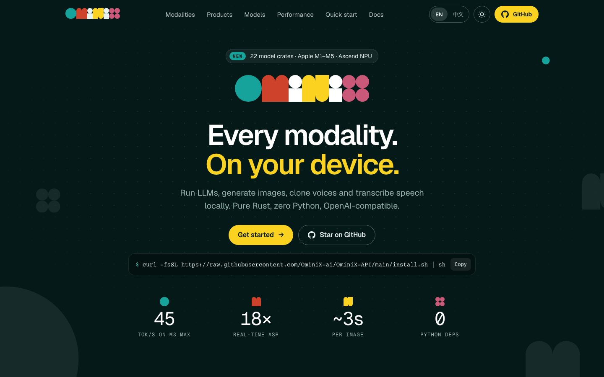

# OminiX Website Redesign: Design Spec & Handoff

> **For the implementing agent.** This folder is the complete brief. Read this file top to bottom once, open `preview.html` (English) and `preview-zh.html` (简体中文) to see the target look, then follow **§8 Implementation plan**. Every asset you need is in `assets/` and is already optimized for the web. Do not regenerate logos or pull imagery from elsewhere.
>
> - `preview.html` (EN) and `preview-zh.html` (中文): working visual references for the hero, bento, products, models band, benchmarks, comparison, quick start and closing band/footer. They share `preview.css` and `preview.js` and switch via the EN | 中文 control in the header. The design kit is on the English page only. It is **reference only**: plain CSS, not production code. Serve the `website/` folder over HTTP and open `/design/preview.html`; opening it as `file://` breaks the relative fonts and images.
> - `screenshots/`: full-page captures at 1440 px (dark and light) and 390 px (dark) for both languages (`*-zh*` = Chinese), plus close-ups of the Voice card (`preview-voice-card*.jpg`).
> - `tokens.css`: a drop-in replacement for the token blocks in `src/styles/global.css`.
> - `assets/`: logos (rebuilt as exact SVG), the shape sprite, app icons, the OG image, and real on-device model outputs: two generated images and **voice clips generated by OminiX-API on this Mac, one set per language** (`assets/audio/en/`, `assets/audio/zh/`).



> ⚠️ **Do not use the deep-sea illustrations** (jellyfish, coral reef, octopus) in `public/images/bg-*.png`. They belong to **octos**, a separate project, and are not OminiX brand material. They have already been **deleted from `public/images/`** in this working tree, together with the two `bgSrc` props that pointed at them (not committed yet).

---

## 1. What's wrong today (diagnosis)

| # | Problem | Evidence |
|---|---|---|
| 1 | **The real logo is never used.** The header and favicon show a placeholder blue "O" in a circle and the word `OMINIX` in monospace. | `src/components/layout/Header.astro:21-25`, `public/favicon.svg`, `src/components/ui/Logo.astro` |
| 2 | **No brand color.** The whole palette is generic Tailwind blue `#3B82F6` and violet `#8B5CF6`. The logo's teal, vermilion, sunflower and rose appear nowhere. | `src/styles/global.css` `@theme`, `ArchitectureFlow.jsx:5-10` |
| 3 | **Another project's art shipped with the site.** `public/images/bg-{circuit,grid,steel}-panel.png` (~17 MB) were octos illustrations: never rendered (`SvgSection` ignores its `bgSrc` prop) but deployed every time. **Already fixed in the working tree:** the files are deleted and the dangling `bgSrc` props removed from `DeepResearch.astro` and `Architecture.astro` (uncommitted; the build still passes). Several component names don't describe their OminiX content either (`DeepResearch` = products, `Memory` = models, `ToolSystem` = API endpoints, `Channels` = hardware, `ContentGen` = voice). | `public/images/`, `src/components/ui/SvgSection.astro:11` |
| 4 | **Every font weight renders the same.** `GeistVF.woff2` and `GeistMonoVF.woff2` are *static single-weight* files: they contain no `fvar`/`gvar` tables. `font-weight: 600` looks identical to 400, which is a large part of why the page reads as flat text. | Table directory checked; measured identical text widths at weights 300/400/600/800 |
| 5 | **The social card is broken.** `Seo.astro` defaults `og:image` to `/og.png`, which does not exist. | `src/components/Seo.astro:12`, `public/` listing |
| 6 | **No imagery or proof.** It is a multimodal AI product with zero images, audio or visuals of output, even though real model outputs exist in `OminiX-MLX/`. | `OminiX-MLX/output_zimage.png`, `output_klein.ppm` |
| 7 | **16 sections with one layout.** Each is eyebrow, H2, grey bordered boxes. Stats appear twice (hero and Stats section), and features, endpoints and voice are split across three near-identical grids. | `src/pages/index.astro` |
| 8 | **Dead code.** `PipelineFlow.jsx`, `Providers.astro`, `LogoGrid.astro`, `AnimatedLink.astro`, `Badge.astro`, `StatItem.astro` and `Logo.astro` are not imported anywhere. `@google/genai` and `playwright` are runtime dependencies that `src/` never uses. | `grep` of imports |

---

## 2. Concept: "Built from the logo"

The OminiX logo is a small Bauhaus system: "ominix" is spelled with only four primitives on a 100-unit grid. Those are a **circle** (o), **arches** (m, n), **squares topped with a dot** (i), and a **2×2 grid of dots** (x). Each letter has one flat color. **That logo is the only source for the whole site.** Every color, shape, icon, chart mark, decoration and the share image come from it. No stock imagery, no third-party art.

It works on two layers:

1. **UI layer.** Cards, chips, buttons, bullets, icons, charts and image frames are drawn with the logo's primitives. Everything is a circle, a half-circle or a square.
2. **Atmosphere layer.** Three full-bleed **night bands** (hero, models, closing/footer). On these, the same primitives appear as large, faint **ghost shapes** (one tone: white ink at 6–7 % opacity) that **bleed off the edges**, over a faint dot grid. The grid echoes the logo's "x" dots.

**Narrative: four glyphs, four senses, one runtime.** The four colored glyphs become the four modalities OminiX runs locally, and that mapping holds everywhere on the site. Teal is language, vermilion is speech in, sunflower is vision, rose is voice out (§4.2).

**Rules that keep it coherent**

- Shapes are **flat**: no gradients, glows, outlines or 3D. Depth comes from scale, cropping and overlap.
- **Restraint with color.** Full-strength brand color goes only on small things: the logo at its set sizes, glyph icons, chips, buttons, charts and accent dots up to about 30 px. Anything larger is a **ghost**: white ink at 6–7 % opacity. The client liked the colors but rejected an 820 px hero wordmark and full-color poster shapes as too loud ("克制一点"). Tinted ghosts don't work either: sunflower, vermilion and rose at low opacity turn muddy olive and brown on night.
- Decorative shapes appear **only on night bands**, always **cropped by the band edge**, and **never behind body text or controls**. On phones only the two bottom-corner shapes remain.
- The logo's proportions are sacred: never re-arrange, recolor or partially draw the wordmark. The footer horizon crops the *whole* wordmark at the page edge and shows it as a one-color white-ink ghost; its shapes are never altered.
- Night bands stay dark in **both** themes. The rest of the page follows the theme.
- The dark palette is the **logo teal's own hue** (OKLCH h ≈ 189°) at low lightness: "teal ink". So even the background is part of the brand.

---

## 3. Asset inventory

All paths are relative to `design/assets/`. The "Copy to" column is the destination in the Astro project.

### 3.1 Logos, shapes and icons

| File | What | Copy to | Use |
|---|---|---|---|
| `logo/ominix-wordmark.svg` | Wordmark, **themeable**: "i" glyphs use `currentColor`, and every glyph has a class (`g g-o`, `g-m`, `g-i1`, `g-n`, `g-i2`, `g-x`) for animation | inline it in `src/components/ui/Logo.astro` (§8.3) | Header, hero, footer horizon |
| `logo/ominix-wordmark-light.svg` / `-dark.svg` | Same wordmark with the ink fixed to black or white | `public/brand/` | `` use, docs, README, press |
| `logo/ominix-stacked-light.svg` / `-dark.svg` | 2-row square lockup ("omi / nix") | `public/brand/` | Social avatars, optional |
| `logo/ominix-mark.svg` | "OX" short mark (teal circle + rose quad) | `public/brand/` | Small spaces, loading states |
| `logo/shapes.svg` | SVG sprite of the logo's primitives: `#dot #arch #cup #block #pip #double-arch #wave #quad #ring` (`currentColor`) | `public/shapes.svg` | Eyebrows, bullets, stat icons, **night-band decorations** |
| `logo/favicon.svg` | OX mark on a rounded `#F7F7FF` tile (same tile color as the macOS app icon `OminiX.icon`) | **replace** `public/favicon.svg` | `<link rel="icon">` |
| `logo/apple-touch-icon.png` (180), `icon-192.png`, `icon-512.png` | Square tile, rasterized from `app-icon-square.svg` | `public/` | Apple touch icon, web manifest |
| `logo/ominix-{studio,api,mlx}.png` / `-dark.png` | Product lockups, trimmed, 160 px tall (2× for 80 px display), palette PNG of about 8–12 KB | `public/brand/` | Product cards, architecture |
| `logo/studio-app-icon.png` | OminiX Studio app icon, 512 px | `public/brand/` | Studio product card |
| `logo/source/*` | Untouched originals from the GitHub org folder | do not ship | Reference only |

The SVG wordmark was rebuilt from the PNG geometry and pixel-diffed against `OminiX.png`: only 0.2 % of pixels differ, all of them on anti-aliased edges. Geometry: viewBox `0 0 2000 400`. "o" = circle r200. "m" = two r100 arches over a 400×300 body. "i" = r100 dot + 200×200 square. "n" = arch (left) + cup (right). "x" = four r100 circles.

### 3.2 Showcase (real on-device outputs)

| File | Source | Caption |
|---|---|---|
| `showcase/zimage-black-cat.{webp,png}` 512² | `OminiX-MLX/output_zimage.png` | "Z-Image-Turbo · on-device · ~3 s" (timing is from `zimage-mlx/README.md`, M3 Max, 4-bit) |
| `showcase/flux-klein-steam-train.{webp,png}` 512² | `OminiX-MLX/output_klein.ppm` (converted) | "FLUX.2-klein · on-device" |

Copy the `.webp` files to `public/images/showcase/`. Alt text must describe the image and say it is AI-generated. **The prompts used are unknown; ask the team (§11) before showing prompt text.**

### 3.3 Voice samples (real on-device TTS output, one set per language)

**Each page only plays its own language.** The English page uses the English set, the Chinese page uses the Chinese set, and languages are never mixed on one page. `voice-samples.json → locales.en / locales.zh` lists which clips each page shows: the English page has **one voice, Aiden**, and the Chinese page has two voices, 薇薇安 (Vivian) and 迪伦 (Dylan), one clip each. **There is no voice-cloning demo**; the client asked for it to be removed. The Japanese and Korean clips made earlier sit in `assets/audio/extra/` and are not used on either page.

All clips were generated on **2026-11-25** by a local release build of **OminiX-API v1.2.0+f481f64** on an **Apple M4 Pro (48 GB)**. The timings are wall-clock request times measured after a warm-up request.

**English page: `assets/audio/en/`**

| File | Speaker | Picker tag | Script | Speaking rate | Longest pause | `speed` | Audio · generated in | ASR |
|---|---|---|---|---|---|---|---|---|
| `en/aiden-excited.m4a` | aiden · excited | Excited | We just shipped it, and the whole thing runs offline! | **4.3 syl/s** | 0.00 s | 1.15× | 3.1 s in 1.4 s | 1.00 |

**English uses Aiden only.** Vivian and Serena are Chinese-native presets with a clear Chinese accent in English, and the client rejected them. Never put them back on the English page. Any new English voice must be a native English preset (aiden, ryan).

**Chinese page (中文): `assets/audio/zh/`**

| File | Speaker | Picker label | Script | Speaking rate | Longest pause | `speed` | Audio · generated in | ASR |
|---|---|---|---|---|---|---|---|---|
| `zh/vivian-zh.m4a` | vivian | 薇薇安 | 你的录音、提示词和声音，都只留在这台设备上。 | **4.4 字/s** | 0.34 s | 1.0× | 4.5 s in 2.0 s | 1.00 |
| `zh/dylan-zh.m4a` | dylan | 迪伦 | 不用 Python，也不用云端，一个 Rust 程序就能跑起来。 | **4.8 字/s** | 0.55 s | 1.15× | 4.1 s in 2.0 s | 1.00 |

**Chinese uses one clip each from Vivian and Dylan** (the client's choice; Serena and the excited Vivian clip were dropped). The picker shows only the Chinese names, **薇薇安** and **迪伦**, with no tags. 薇薇安 is the default.

**Pace rule (learned the hard way).** The first set was correct word-for-word but **far too slow**: 3.3–3.7 syllables/s in English, gaps up to 1.1 s, and the client heard it right away. Correct words are not enough. Every clip on the site must:
1. **Speak at a normal conversational rate.** English 4.2–5.2 syl/s; Chinese 4.3–5.3 字/s (Latin words count by syllable).
2. **Have no pause over 0.7 s.**
3. **Transcribe back to the script** with Qwen3-ASR (≥ 0.97; brand and Latin-word spelling ignored).

Pace levers, in order of preference:
- **(a) A style prompt** (`instruct`): "Speak at a lively, natural conversational pace, a little faster than usual, without long pauses." In Chinese: 用自然流畅的语气说话，语速稍快，句子之间不要停顿太久。
- **(b) The API `speed` parameter.** Above 1.0, qwen3-tts-mlx time-compresses with WSOLA (pitch and timbre preserved).

Preset speakers differ a lot. **Uncle Fu stayed slow** and dropped words in Chinese, so it is not used. **Eric** kept cutting English lines short. The `speed` used is shown on the site in each clip's meta line.

- **How:** every clip comes from `POST /v1/audio/speech` with a preset speaker (`Qwen3-TTS-12Hz-1.7B-CustomVoice-8bit`).
- **Brand pronunciation:** English lines don't say "OminiX", because English presets pronounced it so the ASR heard "OpenAI". The Chinese, Japanese and Korean voices say it clearly.
- **Consent:** only official Qwen3-TTS preset speakers are used. The local model folders also contain GPT-SoVITS voices cloned from real public figures, plus voices named after commercial assistants. **Never use those on the site.**
- **Processing:** each clip was levelled to −20 dBFS RMS (peak ≤ −1 dBFS), then encoded to **AAC-LC 64 kbps mono 24 kHz `.m4a`** (EN ≈ 30 KB, ZH ≈ 80 KB). `<locale>/wav/*.wav` are the levelled masters, used as the `<source>` fallback.
- **`voice-samples.json`** holds `locales` (which clips each page shows) and, per clip: `locale`, `label`, `tag` (optional picker tag; the Chinese clips have none, so their buttons show the name only), `lang` (for the transcript's `lang` attribute), script, model, `speed`, `instruct`, timings, `speaking_rate` + `normal_range`, `max_pause_s`, the ASR transcript, and 56 waveform `peaks`.
- **Reproduce:** `make_voice_samples.py` (dev-only, do not ship) regenerates against a TTS-only `ominix-api` and enforces the pace rule; see its docstring.
- **Copy to** `public/audio/`: `en/`, `zh/` (each with its `wav/`) and `voice-samples.json`. Do not ship `extra/` or the script. Give files a version query or hashed name so browsers never replay a cached older clip.

### 3.4 Social card

`og/og.png` (English) and `og/og-zh.png` (中文), 1200×630, about 50 KB each: a night background with a dot grid, white ghost corner shapes (7 %), a small teal dot, a 380 px full-color wordmark and a tagline in the page's language. Copy them to `public/og.png` and `public/og-zh.png`. `Seo.astro` already defaults to `/og.png`; pass `ogImage="/og-zh.png"` on Chinese pages.

### 3.5 What was taken from the sibling projects

| Source | What was used |
|---|---|
| `/OminiX/*.png`, `OminiX.icon/` (GitHub org logos) | Logo geometry, exact palette, app-icon tile color `#F7F7FF`, product lockups. **This is the single source of the visual system.** |
| `OminiX-MLX/` | Showcase images, the current model list (22 `*-mlx` crates), benchmark numbers from each crate README |
| `.github/profile/README.md` | Product structure (Studio → API → MLX), performance table, "Part of the Moxin Organization" |
| `AI_for_AI_agent/web/static/style.css` | Frosted header recipe (`saturate(180%) blur(20px)` on a 72 % background), radius scale (8/12/18/24, adapted to 8/12/20/28), numbered **step-progress** pattern (used for the Quick Start stepper), icon tiles on cards |
| `website/public/images/bg-*.png` | **Not used.** octos project art. |
| `dora/` | **Not used.** It is the third-party dora-rs project with its own brand. |

---

## 4. Brand foundations

### 4.1 Logo usage

- **Unit:** 1u = logo height ÷ 4 (one grid cell). **Clear space** is at least 1u on all sides.
- **Minimum size:** wordmark 20 px tall, OX mark 16 px tall. Below that, use the favicon tile.
- **Ink glyphs** ("i") are `#000` on light backgrounds and `#FFF` on dark and night backgrounds. Never recolor any other glyph.
- Never stretch, rotate, outline, add shadows or gradients, or re-arrange the glyphs. The footer horizon (§4.5) is the only allowed alteration: the whole wordmark, cropped at the page edge, as a one-color white-ink ghost at 7 % opacity. Everywhere else the wordmark is full color, and in the hero it is 320 px wide at most.
- Do **not** try to typeset "Studio", "API" or "MLX" in the display face used by the product lockups. Use the PNG lockups. That typeface is unidentified (§11).

### 4.2 Color

**Brand (fills).** These are the exact logo values. Each one owns a modality, and that mapping is fixed site-wide.

| Token | Hex | Glyph | Modality / meaning | Use as text? |
|---|---|---|---|---|
| `teal` | `#16A39C` | o | **Language**: LLM, chat (the core) | dark bg only (5.8:1); on light use `teal-text` |
| `vermilion` | `#CE412B` | m | **Speech in**: ASR, transcription | no; use `vermilion-text` |
| `sunflower` | `#FBD220` | n | **Vision**: image gen, VLM, OCR · also the **primary CTA** | dark bg only (12:1); **never on light** (1.4:1) |
| `rose` | `#CA5879` | x | **Voice out**: TTS, voice cloning | no; use `rose-text` |
| `ink` | `#000` / `#FFF` | i | Infrastructure, API, hardware, neutral | yes |

**Text-safe variants** (≥4.5:1 on `bg` and `surface-1` in each theme):

| Token | Dark theme | Light theme |
|---|---|---|
| `teal-text` | `#2EC4BC` (8.4:1) | `#0C756F` (5.2:1) |
| `vermilion-text` | `#F07560` (6.4:1) | `#B8371F` (5.5:1) |
| `sunflower-text` | `#FBD220` (12:1) | `#7A5D00` (5.8:1) |
| `rose-text` | `#E58AA4` (7.4:1) | `#A63F63` (5.6:1) |

**Neutrals.** The dark ramp keeps the logo teal's hue (OKLCH h ≈ 189°) and varies only lightness. The light ramp is warm "paper" with teal-hued text.

| Token | Dark (default) | Light "paper" |
|---|---|---|
| `bg` | `#041918` (night, L 0.195) | `#FBF8F2` |
| `bg-secondary` | `#072120` | `#F3EEE3` |
| `surface-1` (cards) | `#0A2927` | `#FFFFFF` |
| `surface-2` (wells, tracks) | `#133331` | `#F6F2EA` |
| `surface-3` (borders) | `#254543` | `#E5DED0` |
| `text` | `#E7F1F0` (15.8:1) | `#0F2220` (15.6:1) |
| `neutral-2` / `text-dim` | `#98B5B2` (8.3:1) | `#4D5F5D` (6.4:1) |
| `neutral-1` (faint) | `#85A29F` (≥5.6:1) | `#5F706E` (4.9:1) |

Constants that do not flip: `night #041918`, `night-2 #072120`, `on-night #E7F1F0`, `on-night-dim #98B5B2`, `cta #FBD220`, `cta-text #041918` (12.4:1 on sunflower).

**Buttons:** primary is **sunflower with night text**. It is the one loud color and it is 12:1 accessible. White text on teal is only 3.1:1, so teal is never used as a button fill with white text.

**Headings are no longer colored.** Today `--color-heading` makes every H2 blue. In the new system headings use `text-bright`, and color comes from the eyebrow glyph, chips and data.

All of this is in `tokens.css`, which keeps the existing token names so current classes still compile.

### 4.3 Typography

**Fix the fonts first.** Replace the static files with real variable fonts (OFL-1.1):

```bash
npm i @fontsource-variable/geist@5.3.0 @fontsource-variable/geist-mono@5.3.0
```

```astro
// src/layouts/Layout.astro (frontmatter)
import '@fontsource-variable/geist';
import '@fontsource-variable/geist-mono';
```

`tokens.css` already sets `--font-sans: 'Geist Variable', …` and `--font-mono: 'Geist Mono Variable', …`. Delete the two `@font-face` blocks in `global.css`, the two font `preload` links in `Seo.astro`, and `public/fonts/`.

| Role | Size (desktop → mobile) | Weight | Tracking | Font |
|---|---|---|---|---|
| Hero H1 | 68 → 34 px (`clamp(34px,5.4vw,68px)`) | 600 | −0.04em | Geist |
| H2 section title | 56 → 32 px | 600 | −0.035em | Geist |
| H3 card title | 24 px | 600 | −0.025em | Geist |
| Body-L / lede | 19–20 px, line-height 1.55 | 400 | 0 | Geist |
| Body | 16–17 px | 400 | 0 | Geist |
| Eyebrow | 13 px uppercase | 400 | +0.12em | Geist Mono |
| Metric | 36–44 px | 400 | −0.03em | Geist Mono |
| Chip / label | 12 px uppercase | 400 | +0.06em | Geist Mono |
| Code | 14 px, line-height 1.75 | 400 | 0 | Geist Mono |

Use `text-wrap: balance` on headings and `text-wrap: pretty` on ledes. Keep the root font size at 18 px; the sizes above are absolute.

### 4.4 Shape language

Primitives (from `shapes.svg`), each with its own use:

| Shape | Logo origin | Use on the site |
|---|---|---|
| `dot` | o, x | Bullets, status dots, "yes" in tables, stat icon (Language), hero corner circle |
| `ring` | — | "no" in tables, empty states |
| `arch` (round top) | m, n | **Image frames** (`border-radius: 9999px 9999px 0 0`), eyebrow glyph, tab indicator |
| `cup` (round bottom) | n | Alternate image frame (`0 0 9999px 9999px`), paired with arch |
| `double-arch` | m | Stat icon (Speech in), hero bottom-right shape |
| `wave` | n | Stat icon (Vision), hero right-edge shape |
| `pip` (dot + block) | i | Infra/neutral marker, eyebrow for API sections |
| `block` | i stem | Hardware chip tiles |
| `quad` | x | Stat icon (Voice), hero left shape, models-band ghost, **mobile menu icon** (2×2 dots instead of a hamburger) |

**Section eyebrows** always carry a 12 px glyph in the section's color. Cycle the glyphs in logo order (o → m → i → n → i → x) down the page to create rhythm.

**Corners:** cards 20 px, inner wells 12 px, chips and buttons fully round (pill), images in arch or cup frames. There are no sharp 0-radius cards except the `block` glyph itself.

### 4.5 Night bands (atmosphere layer)

Implement one `NightBand.astro` component (code in §8.4) and use it in exactly three places. Each band has a `night` background (`night-2` for models), a **dot grid**, and a fixed composition of logo primitives.

**Dot grid:** `radial-gradient(circle, rgb(255 255 255 / .10) 1.2px, transparent 1.7px)` at `28px 28px`, masked with `radial-gradient(ellipse 70% 62% at 50% 44%, #000 25%, transparent 78%)` so it fades out toward the edges.

**Compositions.** Sizes use `clamp(min, vw, max)`; negative offsets push the shape past the band edge. **Ghost** = the shape in white ink (`color:#fff`) at the stated opacity. Only the small accent dots keep their brand color.

| Band | Shape · color | Size (width) | Position | Notes |
|---|---|---|---|---|
| **Hero** | `dot` · ghost 7 % | `clamp(180px,24vw,380px)` | left `-clamp(100px,11vw,170px)`, bottom `-clamp(80px,9vw,150px)` | The anchor, bottom-left |
| | `double-arch` · ghost 7 % | `clamp(90px,9vw,150px)` | right `clamp(12px,4vw,72px)`, bottom `-clamp(32px,3vw,52px)` | Rises from the bottom edge |
| | `wave` · ghost 7 % | `clamp(56px,6vw,104px)` | right `-clamp(20px,2.4vw,38px)`, top 46 % | Bleeds off the right edge |
| | `quad` · ghost 7 % | `clamp(40px,4vw,68px)` | left `clamp(12px,6vw,110px)`, top 50 % | Floats left of the headline |
| | `dot` · teal (small, full color) | `clamp(14px,1.3vw,22px)` | right 9 %, top 15 % | Keep it clear of the wordmark's "x" or it reads as a fifth dot |
| **Models** | `quad` · ghost 6 % | `clamp(260px,40vw,620px)` | right `-clamp(90px,14vw,220px)`, vertically centered | Ghost shapes; panels sit over them |
| | `dot` · ghost 6 % | `clamp(200px,30vw,460px)` | left `-clamp(100px,16vw,250px)`, top `-clamp(60px,8vw,140px)` | |
| **Closing + footer** | the **whole wordmark**, one-color white-ink ghost 7 % | `min(104vw, 1520px)` | centered, cropped by a `clamp(64px,11.5vw,176px)`-tall `overflow:hidden` box at the very bottom of the page | The "horizon". About 60 % of the logo's height is visible. Glyphs assemble when it scrolls into view. |
| | `dot` · sunflower, `dot` · rose (small, full color) | 18–30 px, 12–20 px | left 14 % top 22 %, right 16 % top 34 % | Hidden on phones |

- **Phones (<768 px):** hide the hero `wave`, `quad` and small `dot` and the closing-band dots. Keep only the hero's bottom-corner circle (left `-110px`, bottom `-110px`) and arch (right `-24px`, bottom `-40px`). In testing, side shapes collided with the install line and the headline.
- All decorative shapes have `aria-hidden="true"` and `pointer-events: none`, with `z-index` behind the content. They drift with `animation: float 26–40s ease-in-out infinite alternate` and staggered negative delays. Nothing drifts under `prefers-reduced-motion`.
- Text on bands uses `on-night` / `on-night-dim`. Panels on bands use `rgb(255 255 255 / .04)` with `backdrop-filter: blur(10px)` and a `rgb(255 255 255 / .10)` border.
- In the light theme the bands stay night-colored and meet the paper sections with a hard edge. That is intentional: Bauhaus color blocking, not a fade.

### 4.6 Imagery and proof

- Show **real outputs** wherever a capability is claimed: generated images in arch/cup frames, a chat mock with a streaming caret, a transcript with mono timestamps, and an animated waveform (rose) for TTS.
- Captions are mono 11–12 px uppercase: model name and timing.
- **Voice is proven with sound, not a fake waveform:** the Voice card plays the real clips from §3.3. Never autoplay; one clip plays at a time.
- Until the team supplies more (§11), use only the two showcase images. **No stock photos, no generic AI-glow imagery, no art from other projects (octos, dora).**

### 4.7 Motion

| Motion | Spec |
|---|---|
| **Logo assembly** (hero on load; footer horizon on scroll-in) | Each glyph: `glyph-in` (from `translateY(40%) scale(.6)`, opacity 0), 800 ms `cubic-bezier(.34,1.56,.64,1)`, `transform-box: fill-box; transform-origin: 50% 100%`. Stagger 80 ms in reading order o, m, i, n, i; then the four x dots pop (`scale(0)` → 1) 60 ms apart. Clicking the hero logo replays it (small easter egg). |
| Scroll reveal | Keep the existing `.reveal` / IntersectionObserver: 28 px rise, 700 ms expo-out, stagger children by 80 ms. |
| Night-band shapes | `float`: 10 px / −22 px translate plus a 2° rotate, 26–40 s, alternate. Subtle; they should feel placed, not floating around. |
| Cards | Hover: `translateY(-3px)` with 400 ms expo, border turns the card's modality color. |
| Buttons | Hover: `translateY(-2px)` spring. Primary lightens to `#FFE15A`. |
| Waveform / caret | `wave` 1.2 s per bar with randomized negative delays; caret blinks at 1 s steps. |
| Benchmark bars | Animate `scaleX` 0 → 1 (origin left) over 900 ms expo when revealed. |
| Header | Transparent over the hero; frosted after `scrollY > 24`. |
| **Reduced motion** | `prefers-reduced-motion: reduce` disables all of the above (block in `tokens.css`). All content and both logos must still be visible. |

### 4.8 Layout and spacing

- Content max width is **1200 px**, gutters `16px` (mobile) and `36px` (≥1024). The existing `px-4 lg:px-9` is right; change `max-w-7xl` to `max-w-[1200px]`.
- Section padding is `py-20 lg:py-28` (80 / 112 px). Night bands use 136 px.
- Section head: eyebrow, then 14 px, then H2, then 18 px, then lede, then 48 px to the content.
- Grid gap 16 px. Bento uses a 6-column grid at ≥900 px.
- Alternate `bg` and `bg-secondary` between consecutive plain sections so the page has rhythm without borders.
- Required: no horizontal scroll at 375 px. Two traps found while building the preview: (1) a flex child holding a `white-space: nowrap` line needs `min-width: 0`; (2) the hero `.wrap` is itself a flex item and needs `width: 100%; min-width: 0`.

---

## 5. Components

| Component | Spec |
|---|---|
| **Header** | 68 px tall, fixed. Over the hero it is transparent with `on-night` text and a white-ink logo. After 24 px of scroll: `background: color-mix(in srgb, var(--color-bg) 72%, transparent)`, `backdrop-filter: saturate(180%) blur(20px)`, bottom border `surface-3`, logo ink = theme ink. Left: wordmark 26 px tall. Center nav (≥960 px), sentence case, 15 px Geist: **Modalities · Products · Models · Performance · Quick start · Docs**. Right: the **EN | 中文** language switch (§7.3), theme toggle (40 px circle) and a primary **GitHub** button (40 px, GitHub mark). On `/zh/` the nav reads 模态 · 产品 · 模型 · 性能 · 快速开始 · 文档. Mobile: the **quad** icon (2×2 rose dots) opens a full-height night sheet with 28 px links. On phones (≤480 px) the GitHub button is icon-only (40 px circle, `aria-label="GitHub"`) so the wordmark never touches the language switch. |
| **Button** | Pill, 48 px (`md`) or 40 px (`sm`), Geist 600 at 16/14 px. `primary` = sunflower bg + `cta-text`. `outline` = 1.5 px `currentColor` at 35 % that becomes 100 % on hover. `link` = accent text + "→". Visible `:focus-visible` ring: 2 px `accent`, offset 2 px. |
| **Chip** | 28 px pill, mono 12 px uppercase, `{color}-soft` bg + `{color}-text`, with an 8 px dot of the fill color. One per modality. |
| **Endpoint label** | Mono 13 px, `text-dim`, 1 px `surface-3` border, radius 8. Example: `POST /v1/chat/completions`. |
| **Card** | `surface-1`, 1 px `surface-3` border, radius 20, padding 28 (24 on mobile), `--shadow-card`. Optional `data-modality` sets the hover border. Optional decorative glyph bleeding off the top-right corner at 14 % opacity. |
| **Install chip** | `rgb(0 0 0 / .32)` on the band, mono 14 px, `$` prompt in `teal-text`, truncates with an ellipsis, **Copy** button (clipboard, then "Copied" for 1.6 s). |
| **Terminal** | Always dark (`#021110`) in both themes. Traffic lights are **vermilion, sunflower, teal** (the logo colors in place of red/yellow/green). Tabs: `curl · python · node` (`role="tablist"`). Syntax: comments `#5F8582`, commands `#2EC4BC`, strings `#FBD220`, flags `#E58AA4`. Copy button. |
| **Stepper** | Three numbered circles (30 px; teal, sunflower, rose) joined by hairlines: *Install → Start the server → Call any endpoint*. Adapted from the `AI_for_AI_agent` progress steps. |
| **Comparison table** | The OminiX column has a `teal-soft` background with an arched header cell (`border-radius: 18px 18px 0 0`). Yes = filled teal dot. No = hollow `ring`. Partial = half-filled dot. |
| **Benchmark bars** | Grouped **by modality**, each group with its own scale and a heading that names the unit ("Language · tokens / s"). Never compare tok/s with ×-real-time on one axis. Track `surface-2`, fill in the modality color, value label inside the end of the bar (mono 14 px; `night` text on teal/sunflower/rose, white on vermilion). Keep a real `<table>` visually hidden for screen readers. |
| **FAQ item** | Question in Geist 500, 20 px. The `+` icon rotates into `×`. Answer max 68ch. The bottom divider is `surface-3`. |
| **Voice player** | One shared `<audio preload="none">` for the card. The player is a 52 px rose play/pause button (night-colored icon, a pulsing ring while playing), a waveform built from `voice-samples.json` peaks (bars resampled to about one per 5 px; played part `rose`, rest `rose` at 32 %) and `0:01 / 0:03` mono time. Click the waveform to seek. It sits on a `surface-2` panel above the spoken line and a meta line, "Qwen3-TTS · preset “aiden” · style “excited” · speed 1.15× · 4.3 syllables/s · generated in 1.4 s" (always disclose a non-1.0 `speed`). **Picker only when a page has more than one preset** (the Chinese page): a `role="radiogroup"` of pill buttons above the player (`aria-checked`, rose-soft when selected) that swaps the clip, the transcript (with the right `lang` attribute) and the meta line. The English page has one voice, so no picker. Use `.m4a` when `canPlayType('audio/mp4; codecs="mp4a.40.2"')`, otherwise the WAV. The play button's `aria-label` is Play/Pause plus the voice name. **Locale:** render only `locales[locale].presets` from `voice-samples.json`; picker labels, the meta line ("Qwen3-TTS · 预设音色“dylan” · 语速 1.15× · 每秒 4.8 字 · 生成耗时 2.0 秒") and aria-labels (播放/暂停) come from the locale strings. **No voice-cloning demo.** Reference implementation: the voice block in `preview.js`. |
| **Logo** | Inline SVG component with `animate` and `class` props (§8.3). |
| **NightBand** | §4.5, §8.4. |
| **Shape** | `<svg viewBox=…><use href="/shapes.svg#name"/></svg>` with the per-symbol viewBox (§8.4). |

---

## 6. Page blueprint

New order, with what each section replaces. ★ marks a section that needs a new visual, not just restyling.

| # | Section | Background | Built from (current files) | Content and visual |
|---|---|---|---|---|
| 0 | Header | transparent → frosted | `layout/Header.astro` | §5 Header. |
| 1 | ★ **Hero** | **night band** (hero composition) | `sections/Hero.astro`, `sections/Stats.astro` (merge, then delete Stats) | Announcement pill → **animated wordmark** (320 px wide, 58vw on mobile: a signature, not a billboard; the `<h1>` contains sr-only "OminiX —") → H1 "Every modality. *On your device.*" (second line in sunflower) → subline → CTAs [Get started →] [★ Star on GitHub] → install chip → 4 stats with glyphs: dot·teal **45** tok/s on M3 Max · double-arch·vermilion **18×** real-time ASR · wave·sunflower **~3 s** per image · quad·rose **0** Python deps. |
| 2 | ★ **Modalities bento** `#modalities` | `bg` | `Features.astro` + `features.json`, `ToolSystem.astro` (endpoints), `ContentGen.astro` (voice) → merge | H2 "Four senses, one local server." Bento (6 cols): **Language** (span 4; chat mock with streaming caret, metric 45 tok/s, endpoint) · **Vision** (span 2, row-span 2; the two showcase images in arch + cup frames with captions, endpoint) · **Speech in** (span 4, row 2; transcript with timestamps + "18× real-time · Paraformer" metric) · **Voice out** (full-width row 3, `#voice`): a working player. Left: chip, H3 "Hear it. Generated on this Mac." and a short intro. Right, on a `surface-2` panel: the player, the spoken line and its meta line. The English page has a single voice (Aiden · Excited) and no picker; the Chinese page adds a picker above the player with two names only, 薇薇安 and 迪伦 (no tags). No voice-cloning demo. Footer: metric computed from that page's clips (EN "2.2× faster than real-time", 中文 "2.1–2.2× 快于实时") and `POST /v1/audio/speech`. See `screenshots/preview-voice-card*.jpg`. OCR and VLM go into the Vision card copy. The remaining `features.json` points (Pure Rust, OpenAI-compatible, dynamic loading…) become a 3-up row of small "pip" bullets under the bento. |
| 3 | **Products** `#products` | `bg-secondary` | `DeepResearch.astro` → rename `Products.astro` | H2 "Three products, one platform." Three cards, each led by its **lockup PNG** (40 px tall, light/dark swap): **Studio** (also show `studio-app-icon.png`), **API**, **MLX**. 2–3 dot bullets each, then "View repository →". Ascend is presented as a backend in Architecture, not as a product card (see §10). |
| 4 | ★ **Architecture** `#architecture` | `bg` | `Architecture.astro` + `ArchitectureFlow.jsx` | Replace React Flow with a responsive HTML/SVG **layer stack**: Studio (top) → API → backends row [MLX · Ascend · CUDA (roadmap chip)] → model crates row colored by modality. Connectors are dashed `surface-3` lines with small brand dots travelling down them (CSS `offset-path` or a translate loop, 3–4 s). Mobile: a vertical stack. If you keep React Flow, at least recolor `BLUE/VIOLET/NEUTRAL` to `teal/rose/surface-3`. |
| 5 | ★ **Models** `#models` | **night band** (`night-2`, ghost quad + circle) | `Memory.astro` → rename `Models.astro` | Eyebrow quad·rose "Model zoo", H2 "Every model is its own crate.", lede "22 Rust crates, downloaded on first use and cached locally…", then four frosted panels (Language 9 / Speech in 4 / Vision 6 / Voice out 3), each with a colored dot, a count and model pills. **Use the real crate list** (§10.1), not the current list. |
| 6 | **Performance** `#performance` | `bg` | `Performance.astro` | H2 "Fast because it's native." Grouped bars per §5. Footnote: "Apple M3 Max, 128 GB. Ascend 910B numbers measured separately." Ascend rows in their own group with an ink `block` glyph. |
| 7 | ★ **Privacy** `#privacy` | `bg-secondary` | `Security.astro` → rename `Privacy.astro` | Left: H2 "Your data never leaves the circle." plus the three points as dot bullets. Right: diagram of a large teal **ring** labeled "your device" with four modality dots orbiting slowly inside (40 s); outside it, a faint dashed cloud shape with a struck-through arrow. |
| 8 | **Hardware** | `bg` | `Channels.astro` → rename `Hardware.astro` | Tiles with a `block` glyph as the chip icon. Apple M-series tiles (ink), Ascend 910B / 310P tiles, and a CUDA tile with a `sunflower-soft` "Roadmap" chip. Status chips: teal "Supported". |
| 9 | **Comparison** | `bg-secondary` | `Comparison.astro` | H2 "More than an LLM runner." Table per §5. |
| 10 | **Use cases** | `bg` | `UseCases.astro` | Keep the 3×2 grid and the mono `01–06` numbers. Add one shape glyph per card in its primary modality color: assistant = dot·teal, voice studio = quad·rose, translation = double-arch·vermilion, edge = pip·ink, enterprise = block·ink, creative = wave·sunflower. Tags become modality chips. |
| 11 | **Quick start** `#quickstart` | `bg-secondary` | `QuickStart.astro`, `ui/CodeBlock.astro` | Stepper + terminal (§5) with curl/python/node tabs. The python tab uses the `openai` client snippet from `.github/profile/README.md`. |
| 12 | **FAQ** `#faq` | `bg` | `FAQ.astro`, `FAQItem.astro`, `faq.json` | Restyle per §5; fix the content per §10. |
| 13 | ★ **Closing + footer** | **night band** (horizon) | `CTA.astro` + `layout/Footer.astro` (merge visually) | Eyebrow dot·teal "Local by default", H2 "Your models. Your machine. No cloud.", CTAs, then about 100 px of space, then the footer row (left: "© 2026 OminiX · Part of the Moxin Organization"; right: GitHub · Docs · Quick start · MIT / Apache-2.0) above a hairline, then the **giant cropped wordmark horizon** as the last thing on the page. |

Delete after the merge: `Stats.astro`, `StatItem.astro`, `Providers.astro`, `LogoGrid.astro`, `PipelineFlow.jsx`, `AnimatedLink.astro` (or reuse it), `Badge.astro` (replaced by Chip), `ui/SvgSection.astro` (replaced by NightBand), and `ArchitectureFlow.jsx` if replaced.

Mobile: every grid collapses to one column. The bento order is Language, Vision, Speech in, Voice out. Hero stats become 2×2. The comparison table scrolls horizontally inside its own container. The terminal `pre` scrolls horizontally.

---

## 7. Copy and internationalisation (English + 简体中文)

Write short, confident, concrete copy, in sentence case everywhere. Mono uppercase is reserved for eyebrows, chips and data labels; drop the all-caps mono nav and buttons. Prefer verbs and numbers to adjectives. The headlines in §6 are proposals; keep the existing body copy where it is still accurate (§10). The preview's chat text, transcript lines and the "NEW" pill are **placeholder mock content** in both languages.

### 7.1 Locales and routing

Two locales: **English** (default, served at `/`) and **简体中文** (served at `/zh/`). Use Astro's built-in i18n routing:

```js
// astro.config.mjs
export default defineConfig({
  site: 'https://www.ominix.ai',
  i18n: {
    defaultLocale: 'en',
    locales: ['en', { path: 'zh', codes: ['zh-CN', 'zh-Hans', 'zh'] }],
    routing: { prefixDefaultLocale: false },
  },
  integrations: [sitemap({ i18n: { defaultLocale: 'en', locales: { en: 'en-US', zh: 'zh-CN' } } }), react()],
  // …
});
```

`src/pages/index.astro` and `src/pages/zh/index.astro` both render the same page component with a `locale` prop. Set `<html lang>` to `en` or `zh-CN`. Do **not** auto-redirect by `Accept-Language`, because crawlers and shared links must get the URL they asked for. The language switch is the only way to change language.

### 7.2 Strings

- One module per locale with identical keys: `src/i18n/en.ts` and `src/i18n/zh.ts` (`export default {…} satisfies typeof en`, so a missing key fails the build). Add a tiny `t(locale)` helper.
- Data files with copy (`features.json`, `faq.json`, `navigation.json`, model and benchmark labels) get a per-locale variant (`faq.en.json` / `faq.zh.json`) or `{ en, zh }` objects.
- **`preview-zh.html` is the source of truth for the Chinese copy.** Have a native speaker on the team review it before launch.
- **Never translate:** product names (OminiX, OminiX Studio / API / MLX), model and crate names, endpoints, code, CLI commands, units (`tok/s`), GitHub. Ascend is "昇腾" in Chinese prose.
- Chinese writing conventions: full-width punctuation (，。！：), Chinese quotes “”, a half-width space between Chinese and Latin/numbers ("纯 Rust 实现", "18 倍实时", "约 3 秒").

### 7.3 Language switch

A segmented pill in the header, **EN | 中文**, placed before the theme toggle and visible on mobile. It is two plain links (`hreflang` + `lang` on each, `aria-current="true"` on the current one) pointing to the same section on the other locale, keeping `#hash`. Use `role="group"` with `aria-label="Language"` / "语言", not a `<nav>`.

### 7.4 SEO per locale

- On both pages: `<link rel="alternate" hreflang="en" href="/">`, `hreflang="zh-CN" href="/zh/"` and `hreflang="x-default" href="/"`, plus a self-canonical.
- Localized `<title>`, description and `og:locale` (`en_US` / `zh_CN`), and `og:image` (`/og.png` / `/og-zh.png`).
- The sitemap lists both URLs with alternates (config above).

### 7.5 Chinese typography (`html[lang="zh-CN"]`, see the bottom of `preview.css`)

- **Fonts:** Geist has no CJK glyphs. Stack `'Geist Variable', 'PingFang SC', 'Hiragino Sans GB', 'Noto Sans SC', 'Microsoft YaHei', system-ui, sans-serif` so Latin stays Geist and Han uses the system face. Mono: `'Geist Mono Variable', 'PingFang SC', 'Noto Sans SC', ui-monospace, monospace`. Do not self-host a CJK webfont (multi-MB).
- **No negative letter-spacing** on Chinese headings (0), and taller line-heights: hero 1.2, H2 1.25, body/ledes 1.8.
- **No `text-transform: uppercase`** on Chinese eyebrows, chips or labels; letter-spacing 0.04em.
- **Break headlines only between phrases.** Chinese can break between any two characters, which split "就在" across lines in testing. Wrap each phrase in an inline-block span (`<span class="nw">全模态 AI，</span><em class="nw">就在你的设备上。</em>`). Do it with a helper that splits headline strings after ，。！？、 instead of hand-writing spans.

### 7.6 Per-locale assets

- Voice clips: English set on `/`, Chinese set on `/zh/` (§3.3). Never mix.
- OG image: `og.png` / `og-zh.png` (§3.4).
- Image alt text, chat and transcript mock text, and the voice card's meta line are all localized. The logo, shapes, screenshots of code and model names are shared.

---

## 8. Implementation plan

Work in this order and commit after each step.

### 8.1 Assets and head

1. Copy the assets per §3: `public/brand/`, `public/images/showcase/`, `public/audio/` (§3.3), `public/shapes.svg`, `public/favicon.svg`, `public/apple-touch-icon.png`, `public/icon-192.png`, `public/icon-512.png`, `public/og.png` and `public/og-zh.png`.
2. **Already done:** `public/images/bg-circuit-panel.png`, `bg-grid-panel.png` and `bg-steel-panel.png` (octos art, ~17 MB) are deleted and their `bgSrc` references removed. Review and commit those changes with this work.
3. In `Seo.astro`, add the links below and remove the two Geist preload links.

```html
<link rel="apple-touch-icon" href="/apple-touch-icon.png" />
<meta name="theme-color" content="#041918" />
<meta property="og:image:width" content="1200" /><meta property="og:image:height" content="630" />
```

### 8.2 Tokens and fonts

4. Replace the `@theme` / `html[data-theme=…]` blocks in `src/styles/global.css` with `tokens.css`. Keep it as **`@theme static`**: without `static`, Tailwind 4.2 drops any theme variable that no utility class references (tested), so tokens used only in component `<style>` blocks or inline styles silently disappear. Keep the `@import "tailwindcss";` line and the existing `@layer` rules, then restyle `.glass-panel` / `.glass-box`: replace blue borders with `surface-3`.
5. Install the variable fonts (§4.3).
6. Set heading weights to 600 in the base layer (`h1…h3 { font-weight: 600; color: var(--color-heading) }`).

### 8.3 `Logo.astro`

Replace the unused `src/components/ui/Logo.astro` with:

```astro
---
interface Props { class?: string; animate?: 'load' | 'view'; label?: string; decorative?: boolean }
const { class: className, animate, label = 'OminiX', decorative = false } = Astro.props;
---
<svg viewBox="0 0 2000 400" class:list={['ominix-logo', { 'play-in': animate === 'load' }, className]}
     data-play-on-view={animate === 'view' ? '' : undefined}
     {...(decorative ? { 'aria-hidden': 'true' } : { role: 'img', 'aria-label': label })}>
  <circle class="g g-o" cx="200" cy="200" r="200" fill="#16A39C"/>
  <path class="g g-m" d="M400 400V100a100 100 0 0 1 200 0a100 100 0 0 1 200 0v300z" fill="#CE412B"/>
  <g class="g g-i1" fill="currentColor"><circle cx="900" cy="100" r="100"/><rect x="800" y="200" width="200" height="200"/></g>
  <path class="g g-n" d="M1000 400V100a100 100 0 0 1 200 0v300zM1200 0h200v300a100 100 0 0 1-200 0z" fill="#FBD220"/>
  <g class="g g-i2" fill="currentColor"><circle cx="1500" cy="100" r="100"/><rect x="1400" y="200" width="200" height="200"/></g>
  <g class="g-x" fill="#CA5879"><circle cx="1700" cy="100" r="100"/><circle cx="1900" cy="100" r="100"/><circle cx="1700" cy="300" r="100"/><circle cx="1900" cy="300" r="100"/></g>
</svg>
<style>
  .ominix-logo { height: auto; color: var(--color-ink); overflow: visible; }
  .g, .g-x circle { transform-box: fill-box; transform-origin: 50% 100%; }
  .g-x circle { transform-origin: center; }
  [data-play-on-view]:not(.play-in) :is(.g, .g-x circle) { opacity: 0; }
  .play-in .g { animation: glyph-in .8s var(--ease-spring) both; }
  .play-in .g-o { animation-delay: .05s } .play-in .g-m { animation-delay: .13s }
  .play-in .g-i1 { animation-delay: .21s } .play-in .g-n { animation-delay: .29s }
  .play-in .g-i2 { animation-delay: .37s }
  .play-in .g-x circle { animation: dot-in .6s var(--ease-spring) both; }
  .play-in .g-x circle:nth-child(1) { animation-delay: .45s } .play-in .g-x circle:nth-child(2) { animation-delay: .51s }
  .play-in .g-x circle:nth-child(3) { animation-delay: .57s } .play-in .g-x circle:nth-child(4) { animation-delay: .63s }
  @keyframes dot-in { from { opacity: 0; transform: scale(0) } to { opacity: 1; transform: none } }
  @media (prefers-reduced-motion: reduce) { [data-play-on-view] :is(.g, .g-x circle) { opacity: 1 !important; } }
</style>
<noscript><style>[data-play-on-view] .g, [data-play-on-view] .g-x circle { opacity: 1 !important; }</style></noscript>
```

Uses:
- **Header:** `<Logo class="h-[26px] w-auto" />`. Set `color` to `on-night` over the hero and to `var(--color-ink)` after scroll.
- **Hero:** `<Logo animate="load" decorative class="w-[320px] max-w-[58vw]" />`. The H1 carries the name.
- **Footer horizon:** `<Logo animate="view" decorative class="horizon-mark text-white" />`, shown as a one-color ghost: `.horizon-mark { opacity: .07 } .horizon-mark :is(.g, .g-x) { fill: #fff }` (CSS `fill` overrides the glyphs' `fill` attributes). In the existing IntersectionObserver in `Layout.astro`, also observe `[data-play-on-view]` and add `play-in` when it intersects.

### 8.4 `NightBand.astro` + `Shape.astro`

`src/components/ui/Shape.astro`:

```astro
---
const VB = { dot: '0 0 200 200', ring: '0 0 200 200', block: '0 0 200 200', arch: '0 0 200 400', cup: '0 0 200 400',
             pip: '0 0 200 400', 'double-arch': '0 0 400 400', wave: '0 0 400 400', quad: '0 0 400 400' } as const;
interface Props { name: keyof typeof VB; class?: string; style?: string }
const { name, class: className, style } = Astro.props;
---
<svg viewBox={VB[name]} class={className} style={style} aria-hidden="true" focusable="false"><use href={`/shapes.svg#${name}`} /></svg>
```

`src/components/ui/NightBand.astro` replaces `ui/SvgSection.astro`:

```astro
---
import Shape from './Shape.astro';
interface Props { variant: 'hero' | 'models' | 'closing'; id?: string; class?: string }
const { variant, id, class: className } = Astro.props;
---
<section id={id} class:list={['night-band relative isolate overflow-hidden text-on-night',
  variant === 'models' ? 'bg-night-2' : 'bg-night', `nb-${variant}`, className]}>
  <div class="dotgrid" aria-hidden="true"></div>
  {variant === 'hero' && <>
    <Shape name="dot" class="deco ghost d-circle text-white" />
    <Shape name="double-arch" class="deco ghost d-arch text-white" />
    <Shape name="wave" class="deco ghost d-wave text-white" />
    <Shape name="quad" class="deco ghost d-quad text-white" />
    <Shape name="dot" class="deco d-dot text-teal" />
  </>}
  {variant === 'models' && <>
    <Shape name="quad" class="deco ghost d-quad text-white" />
    <Shape name="dot" class="deco ghost d-circle text-white" />
  </>}
  {variant === 'closing' && <>
    <Shape name="dot" class="deco d-dot1 text-sunflower" />
    <Shape name="dot" class="deco d-dot2 text-rose" />
  </>}
  <slot />
</section>
<style>
  /* Port the sizes and positions from §4.5 (and the .hero/.models/.cta-band rules in preview.html). */
  .dotgrid { position: absolute; inset: 0; z-index: -2; pointer-events: none;
    background-image: radial-gradient(circle, rgb(255 255 255 / .10) 1.2px, transparent 1.7px); background-size: 28px 28px;
    mask-image: radial-gradient(ellipse 70% 62% at 50% 44%, #000 25%, transparent 78%); }
  .deco { position: absolute; z-index: -1; height: auto; pointer-events: none; animation: var(--animate-float); }
  .nb-hero .ghost { opacity: .07; } .nb-models .ghost { opacity: .06; } /* large shapes: white-ink ghosts, never bright fills */
  /* …per-variant .d-* rules from §4.5… */
</style>
```

### 8.5 Sections

7. Set up i18n first (§7.1–7.3): Astro `i18n` config, `src/i18n/en.ts` + `zh.ts`, `src/pages/zh/index.astro`, the header language switch, and per-locale `Seo` props (§7.4). Then build `src/components/sections/VoicePlayer.astro` with a `locale` prop (no React needed): import `public/audio/voice-samples.json` at build time, render that locale's player (plus the picker when it has more than one preset) server-side, and port the voice block from `preview.js`.
8. Header, then Hero (+ Stats merge), then Modalities, Products, Architecture, Models, Performance, Privacy, Hardware, Comparison, Use cases, Quick start, FAQ, Closing + Footer. Follow §6 and use `preview.html` / `preview-zh.html` as the visual source of truth for each language. Update `index.astro`, `navigation.json`, the header and the footer nav to the new anchors.
9. Delete the dead components (§1 #8, §6). Optional: move `playwright` to `devDependencies`, drop `@google/genai` (unused), and drop `@xyflow/react` if Architecture no longer uses it.

### 8.6 Verify

10. `npm run build` passes, then run `npm run preview` and check 375 / 768 / 1440 px in both themes against `screenshots/`.

---

## 9. Acceptance checklist

- [ ] Real logo in the header, hero (animated on load), footer horizon (animated on scroll-in) and favicon. No blue `#3B82F6` or violet left (`grep -ri "3B82F6\|8B5CF6\|2563EB" src` returns nothing).
- [ ] No octos art anywhere: `public/images/bg-*.png` are deleted and nothing references them.
- [ ] The three night bands render with the compositions in §4.5; on phones only the two hero bottom-corner shapes show. Large shapes and the footer wordmark are white ghosts (6–7 %), never solid color; the hero wordmark is 320 px wide.
- [ ] Headings visibly render at weight 600 (the variable font is loaded; check DevTools → Rendered Fonts shows *Geist Variable*).
- [ ] `/og.png` resolves; Twitter/LinkedIn card validators show the image.
- [ ] Both showcase images appear in arch/cup frames with captions and descriptive alt text.
- [ ] i18n: `/` is English and `/zh/` is Chinese with identical sections; the EN | 中文 switch keeps the section; `lang`, hreflang (en, zh-CN, x-default), canonical, title, description, `og:locale` and `og:image` are correct per page; no English UI strings left on `/zh/` except names that are never translated (§7.2); Chinese headlines break only between phrases.
- [ ] Voice card: each page plays **only its own language's clips** (EN: Aiden only, no picker; 中文: 薇薇安, 迪伦). No voice-cloning demo, and never Vivian or Serena on the English page. Every clip plays (Safari, Chrome, Firefox), only one at a time, waveform progress and time stay in sync, click-to-seek works, the picker (中文) updates the transcript and meta line, nothing autoplays, and the play buttons work from the keyboard with correct Play/Pause labels.
- [ ] Every text/background pair is ≥4.5:1 (≥3:1 for ≥24 px). No sunflower text on light backgrounds. No decorative shape sits behind text or controls.
- [ ] `prefers-reduced-motion` gives a static page with all content and both logos visible.
- [ ] No horizontal scroll at 375 px (`document.documentElement.scrollWidth === innerWidth`).
- [ ] Keyboard: visible focus rings; terminal tabs reachable with arrow keys; FAQ `<details>` works.
- [ ] Lighthouse (mobile): Performance ≥ 90, Accessibility ≥ 95, CLS < 0.05, LCP < 2.5 s. The night bands are pure CSS/SVG, so there are no hero image bytes.
- [ ] Light theme: paper sections, night bands stay dark, product lockups swap to the black-ink versions.

---

## 10. Content notes: confirm with the team, don't change silently

1. **Model list is outdated.** The site says "14 model crates". `OminiX-MLX` now has **22** `*-mlx` crates: qwen3, qwen3.5-35B, glm4, glm4-moe, glm-4.7-flash, mixtral, mistral, gemma4, minicpm-sala (language); qwen3-asr, funasr (Paraformer), funasr-nano, funasr-qwen4b (speech in); flux-klein, zimage, qwen-image, qwen3-vl, moxin-vlm, deepseek-ocr2 (vision); qwen3-tts, gpt-sovits, step-audio2 (voice out). `Memory.astro` lists **Llama 2/3, Phi-3/4, DeepSeek (LLM), Whisper, SenseVoice, CosyVoice**, which have no crate in OminiX-MLX. Verify before publishing.
2. **Apple chips:** the site and FAQ say M1–M4; the org README says **M1–M5**.
3. **Image speed:** the site says FLUX.2-klein "~5 s/image". `zimage-mlx` README says Z-Image-Turbo **~3 s** (4-bit, M3 Max). Label which model each number belongs to.
4. **TTS speed:** GPT-SoVITS is "3–4×" (org README) vs "4×" (MLX README). The site shows Qwen3-TTS 2.3×.
5. **ASR languages:** the site credits "30+ languages, 18× real-time" to Paraformer. Per the MLX README, Paraformer is Chinese/English at 18×, and **Qwen3-ASR** covers 30 languages at 30–50×.
6. **Products:** the site's three products are MLX / API / **Ascend**; the org README's are MLX / API / **Studio**. This spec uses Studio + API + MLX and shows Ascend as a backend. There is no public Ascend repo link.
7. **License:** the footer says "MIT License"; the repos are dual **MIT / Apache-2.0**.
8. **Docs link:** `https://docs.ominix.ai` is linked in the nav. Confirm it resolves before shipping.
9. **Studio platforms:** the preview lists "macOS · Windows · Linux" (based on the org README's "cross-platform via Makepad"). Confirm which platforms actually ship.

## 11. Assets still missing (request from the team)

| Need | Why | Spec |
|---|---|---|
| OminiX Studio screenshots (light and dark) | Products card, possibly the hero | PNG at 2×, 1600×1000, real UI, no lorem |
| 15–30 s Studio screen recording | Motion proof in Products/hero | MP4 (H.264) + WebM, ≤4 MB, muted, loopable, 1280 px wide, poster frame |
| (Optional) Voice clips re-generated on the M3 Max | Match the benchmark table's hardware (current clips: M4 Pro) | Run `assets/audio/make_voice_samples.py` |
| Prompts + timings for the two showcase images, plus 4–6 more outputs | Captions, a small gallery | 512–1024 px PNG, prompt text, model, hardware, seconds |
| Native-speaker review of the Chinese copy (`preview-zh.html`) | Machine-quality Chinese must not ship | Edits go into `src/i18n/zh.ts` |
| Name or license of the display typeface in the Studio / MLX / API lockups | Only needed if new product names must be typeset | — |
| Ascend lockup (optional) | Only if Ascend becomes a product card again | Same construction as the other lockups |
